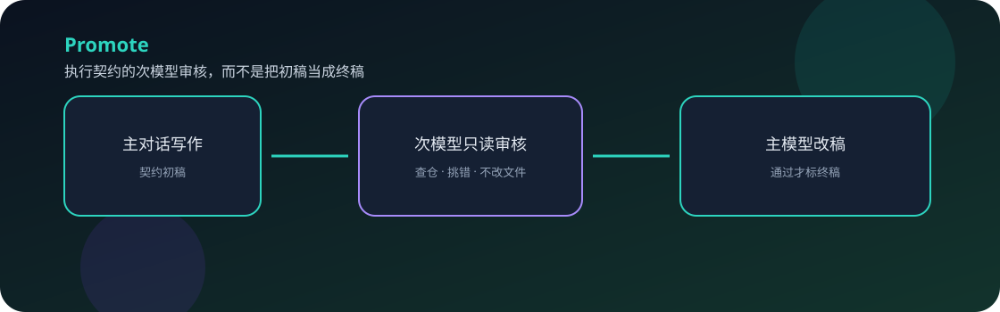
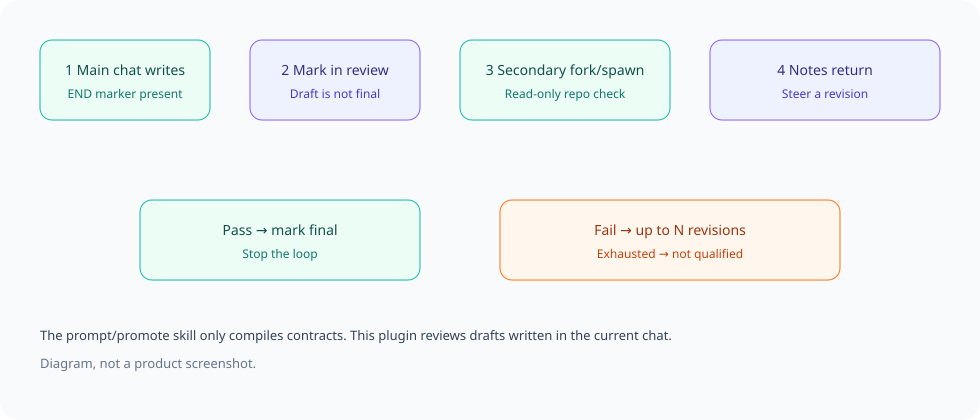

<div align="center">
  
  <h1>Promote</h1>
  <p><strong>Write an execution contract in the current chat. A secondary model reviews it read-only. Do not treat a draft as final until it passes.</strong></p>
  <p>A DeepSeek Harness desktop plugin, plus the <code>prompt</code> / promote skill that compiles contracts.</p>
  <p><a href="README.md">简体中文</a> · <strong>English</strong></p>
  <p><a href="LICENSE">MIT</a> · version 0.1.6</p>
  <p><a href="#features">Features</a> · <a href="#how-it-works">How it works</a> · <a href="#quick-start">Quick start</a> · <a href="#configuration">Configuration</a> · <a href="#validation">Validation</a> · <a href="#faq">FAQ</a></p>
</div>

---

The writing side is always the current conversation. When unquoted `[END OF EXECUTION PROMPT]` appears in visible assistant text — including a prompt-skill fenced contract — the plugin marks the draft **in review** and **waits inside `turn-stopping`** until the secondary model finishes. It does not depend on the parent calling `promote`. Pass marks a final draft; failures or timeouts wake the parent to revise or retry. `skills/prompt` **compiles** contracts only.

## Features

<table>
<tr>
<td><strong>Auto review</strong><br/>Triggers on an unquoted end marker. The writing turn waits in the stop hook until review finishes, without requiring a <code>promote</code> call.</td>
<td><strong>Models A / B</strong><br/>Try A first; if A matches the current session model, use B. Reasoning effort is selectable and passed in real <code>agentOptions</code>.</td>
</tr>
<tr>
<td><strong>Read-only child</strong><br/>Pins a <code>read-only</code> sandbox and denies edit/write/bash. The child must open workspace sources; empty <code>pathsRead</code> cannot pass.</td>
<td><strong>Seven review rules</strong><br/>Evidence, call chain, fact layers, scope, acceptance, local rules, and brevity. Sidebar and reviewer share the same list.</td>
</tr>
<tr>
<td><strong>Bounded loop</strong><br/>Default 3 rounds (1–5). Until a final or unqualified mark appears, the draft is not qualified.</td>
<td><strong>prompt skill</strong><br/>Compiles confirmed goals into a contract for a new session. Install to <code>~/.dsh/skills/prompt</code>.</td>
</tr>
</table>

## How it works



1. The current chat (or the prompt skill) writes a contract whose body includes `[END OF EXECUTION PROMPT]`.
2. The plugin injects in-review status and awaits the secondary model inside `turn-stopping`.
3. Pass marks final. Failures wake the parent to revise. Timeouts are retryable with `promote` (120s).
4. The explicit `promote` tool can still wait or join an in-flight review of the same hash.

## Quick start

### 1. Prerequisites

- DeepSeek Harness desktop
- A logged-in account usable as the secondary model
- A full quit and reopen (Cmd+Q on macOS) after install

### 2. Install the plugin

Copy this repository to `$DSH_HOME/plugins/promote` (macOS default `~/.dsh/plugins/promote`). Add a link dependency and bundle in `$DSH_HOME/profiles/desktop/package.json`:

```json
{
  "dependencies": {
    "promote": "link:/Users/YOU/.dsh/plugins/promote"
  },
  "dsh": {
    "profile": {
      "bundles": ["promote"]
    }
  }
}
```

Install the link from that desktop profile so the package resolves:

```bash
cd "$DSH_HOME/profiles/desktop"
pnpm install
```

The package `cordis.patch.yml` inserts `id: promote`. Do not empty the existing `profiles/desktop/cordis.patch.yml`.

### 3. Install the prompt / promote skill

```bash
mkdir -p "$DSH_HOME/skills"
cp -R skills/prompt "$DSH_HOME/skills/prompt"
```

Say “生成 prompt”, “生成 promote”, or use `/prompt`. The skill only compiles; it does not edit the project.

### 4. Configure and verify

Quit DeepSeek Harness fully (Cmd+Q) and reopen. Open **Promote** in the right sidebar:

- Set secondary models A and B and each reasoning effort (A and B cannot be the same)
- Save (writes `$DSH_HOME/storages/promote/settings.json`, mode 0600)
- If the current session model equals A, this round uses B

## Configuration

| Item | Default | Notes |
| --- | --- | --- |
| Models A / B | unset | `provider/model`, optional `reasoningEffort` |
| Max revisions | 3 | Range 1–5 |
| Auto review | on | Use the `promote` tool when off |
| Review timeout | 120s | Host constant, not in the sidebar |

Missing A/B, A equals B, or both matching the current session model: no review this round, visible failure in chat and sidebar, no self-review.

<details>
<summary><strong>Advanced: API, data location, and rules</strong></summary>

- API: `/api/promote` (GET/POST)
- Settings: `$DSH_HOME/storages/promote/settings.json`
- Sidebar `kind` is the unique value `promote`
- Review rules match the sidebar and the child prompt: evidence, call chain, fact layers, closed scope, acceptance, no conflict with AGENTS.md/skills, short enough to execute; read-only sandbox, no edit/write/multi_edit/bash, empty `pathsRead` cannot pass

</details>

## Validation

From the plugin directory, with local Node (`/usr/local/bin/node`):

```bash
/usr/local/bin/node --check lib/index.js
/usr/local/bin/node --check lib/client.js
/usr/local/bin/node --test
```

0.1.6 covers pinning a read-only sandbox, failing bash/write tools, using observed read paths, and a 4-second session-status poll that does not overwrite unsaved form fields. Unit tests do not replace desktop visibility after Cmd+Q.

## FAQ

**I changed the files and the UI did not?** Quit fully with Cmd+Q. Reload is not enough.

**The sidebar says it is unconfigured?** Saving is required even if the dropdowns show values.

**The model I picked snapped back?** The sidebar polls review status every 4 seconds and does not overwrite unsaved A/B. Changing A/B still requires Save. Use Refresh to reload the model list.

**A is the same model as this chat?** The round uses B. That is intentional.

**How do the skill and plugin relate?** The skill writes contracts; the plugin reviews a contract already written in the current chat. Either can be used alone.

**I wrote a contract but nothing was marked in review?** Blockquote (`>`) and inline-code markers are ignored. A prompt-skill fenced contract is reviewed. Quit fully with Cmd+Q after plugin changes.

**Why did the main chat look finished?** From 0.1.5 the stop hook awaits the review (if the Host waits on async hooks, the writing turn does not complete first). Failures or timeouts then wake the parent. This is still not the official subagent pending-tool heartbeat.

## Community and license

The public repository topic is `dsh-plugin`. See [LICENSE](LICENSE) (MIT). User settings, credentials, and session logs are not in this tree.

<div align="center"><sub>Review the draft before calling it final · <a href="README.md">阅读中文版 →</a></sub></div>
