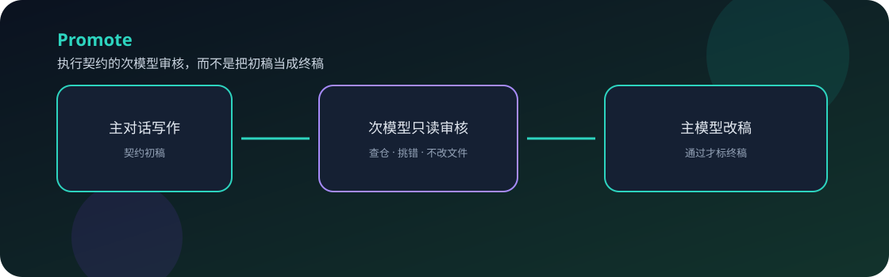
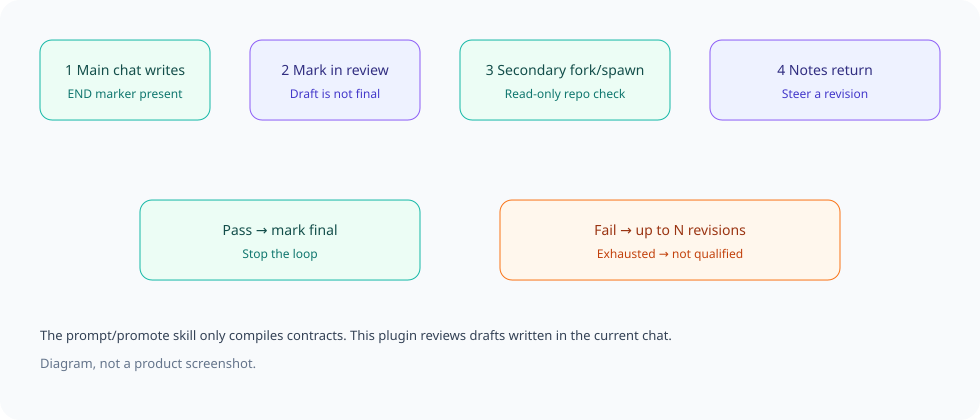

<div align="center">
  
  <h1>Promote</h1>
  <p><strong>Write an execution contract in the current chat. A secondary model reviews it read-only. Do not treat a draft as final until it passes.</strong></p>
  <p>A DeepSeek Harness desktop plugin, plus the <code>prompt</code> / promote skill that compiles contracts.</p>
  <p><a href="README.md">简体中文</a> · <strong>English</strong></p>
  <p><a href="LICENSE">MIT</a> · version 0.1.19</p>
  <p><a href="#features">Features</a> · <a href="#how-it-works">How it works</a> · <a href="#quick-start">Quick start</a> · <a href="#configuration">Configuration</a> · <a href="#validation">Validation</a> · <a href="#faq">FAQ</a></p>
</div>

---

**Host compatibility:** Review requires verifiable pre-activation read-only protection, trusted evidence APIs, and a Host-enforced workspace read boundary. Missing capability returns `READ_ONLY_UNAVAILABLE`; insufficient or out-of-workspace evidence cannot produce a pass. On 2026-11-01, real non-code material and supported TypeScript call-chain reviews passed on a locally customized DSH Desktop 0.2.2-alpha.2. This does not establish compatibility with every Host or language server. `skills/prompt` **compiles** contracts only.

## Features

<table>
<tr>
<td><strong>Auto review</strong><br/>Triggers on an unquoted end marker. The writing turn waits in the stop hook until review finishes, without requiring a <code>promote</code> call.</td>
<td><strong>Models A / B</strong><br/>Try A first; use B when A matches the current session model or is outside the Session route policy. Reasoning effort is passed in real <code>agentOptions</code>.</td>
</tr>
<tr>
<td><strong>Read-only protection</strong><br/>Review is refused when pre-activation protection cannot be verified. Reads are confined to the task root, and a pass that still lists issues is rejected.</td>
<td><strong>Seven review rules</strong><br/>Evidence, call chain, fact layers, scope, acceptance, local rules, and brevity. Sidebar and reviewer share the same list.</td>
</tr>
<tr>
<td><strong>Bounded loop</strong><br/>Default 3 rounds (1–5). Until a final or unqualified mark appears, the draft is not qualified.</td>
<td><strong>prompt skill</strong><br/>Clarifies unknowns that would change the result, adds a structural-design gate for non-trivial code work, and compiles the goal into a contract for a new session. Install to <code>~/.dsh/skills/prompt</code>.</td>
</tr>
</table>

## How it works



1. The current chat (or the prompt skill) clarifies blocking unknowns and writes a contract whose body includes `[END OF EXECUTION PROMPT]`.
2. The plugin injects in-review status and awaits the secondary model inside `turn-stopping`.
3. When Host protection and evidence are available, the plugin runs the review and marks a passing draft final. Missing capability fails explicitly; retryable failures are reported, with a unified timeout of 1200s.
4. The explicit `promote` tool can still wait or join an in-flight review of the same hash.

## Quick start

### 1. Prerequisites

- DeepSeek Harness desktop
- A logged-in account usable as the secondary model
- A full quit and reopen (Cmd+Q on macOS) after install

### 2. Install the plugin

Copy this repository to `$DSH_HOME/plugins/promote` (macOS default `~/.dsh/plugins/promote`). Add a link dependency and bundle in `$DSH_HOME/profiles/desktop/package.json`:

```json
{
  "dependencies": {
    "promote": "link:/Users/YOU/.dsh/plugins/promote"
  },
  "dsh": {
    "profile": {
      "bundles": ["promote"]
    }
  }
}
```

Install the link from that desktop profile so the package resolves:

```bash
cd "$DSH_HOME/profiles/desktop"
pnpm install
```

The package `cordis.patch.yml` inserts `id: promote`. Do not empty the existing `profiles/desktop/cordis.patch.yml`.

### 3. Install the prompt / promote skill

```bash
mkdir -p "$DSH_HOME/skills"
cp -R skills/prompt "$DSH_HOME/skills/prompt"
```

Say “生成 prompt”, “生成 promote”, or use `/prompt`. The skill only compiles; it does not edit the project.

### 4. Configure and verify

Quit DeepSeek Harness fully (Cmd+Q) and reopen. Open **Promote** in the right sidebar:

- Set secondary models A and B and each reasoning effort (A and B cannot be the same)
- Save (writes `$DSH_HOME/storages/promote/settings.json`, mode 0600)
- If the current session model equals A, or A is outside the Session route policy, this round uses B

## Configuration

| Item | Default | Notes |
| --- | --- | --- |
| Models A / B | unset | `provider/model`, optional `reasoningEffort` |
| Max revisions | 3 | Range 1–5 |
| Auto review | on | Use the `promote` tool when off |
| Review timeout | 1200s | Host constant, not in the sidebar |

Missing A/B, A equals B, or both matching the current session model: no review this round, visible failure in chat and sidebar, no self-review. Sessions with a recorded `subagent/model-selection-policy` only expose routes in its allowlist. For legacy sessions without that policy, DSH permits only the current main route; because self-review is forbidden, review is explicitly refused and a new session is required. The current model comes from the active session Agent's selection; older Agents without that API use the session model projection and request header. If the route cannot be confirmed, review is refused with a specific reason; the global default is not substituted.

For non-code material review, the original user message must contain the standalone line `non-code scope: non-code materials only`, and the contract must identify the material to inspect; ordinary documents mentioning APIs or tests are no longer misclassified as source code. Configuration files must be read but do not require a fabricated LSP call chain. Code reviews require a trusted LSP. Local acceptance covered a restricted single TypeScript project; trusted queries do not support `tsconfig` `extends`, `references`, or TypeScript plugins. Review fails closed when source snapshots cannot be bound, call-chain evidence is missing, or a `passed: true` verdict still contains issues.

Call-chain nodes use one-based line and UTF-16 character coordinates. Each intermediate node in a multi-hop chain also identifies the next call site inside its function. A compatible Host must prove in the same trusted TypeScript query that the position is a call and belongs to that function. In addition to named functions, methods, and `const`-bound functions, this supports explicit non-overloaded constructors in `const`-bound class expressions without inheritance. An inline anonymous callback forms a static edge only when its receiver is a `const`-bound arrow function in the same file that directly invokes the corresponding parameter at the top level of its body. Unverified ownership or invocation still fails closed; static evidence does not prove that a runtime branch or dynamic dispatch target actually executes.

<details>
<summary><strong>Advanced: API, data location, and rules</strong></summary>

- API: `/api/promote` (GET/POST)
- Settings: `$DSH_HOME/storages/promote/settings.json`
- Sidebar `kind` is the unique value `promote`
- Review rules appear in the sidebar: code contracts require successful source reads and LSP call-chain evidence; non-source tasks require their actual materials. Unverified pre-activation protection or tool evidence must not result in a pass.

</details>

## Validation

From the plugin directory, with local Node (`/usr/local/bin/node`):

```bash
/usr/local/bin/node --check lib/index.js
/usr/local/bin/node --check lib/client.js
/usr/local/bin/node --test
```

The prompt skill requires LSP call-chain verification for code-related contracts. Unit tests do not replace desktop runtime verification after Cmd+Q; different Hosts, language servers, and project configurations require separate validation.

## FAQ

**I changed the files and the UI did not?** Quit fully with Cmd+Q. Reload is not enough.

**The sidebar says it is unconfigured?** Saving is required even if the dropdowns show values.

**The model I picked snapped back?** The sidebar polls review status every 4 seconds and does not overwrite unsaved A/B. Changing A/B still requires Save. Use Refresh to reload the model list.

**A is the same model as this chat?** The round uses B. That is intentional.

**How do the skill and plugin relate?** The skill writes contracts; the plugin reviews a contract already written in the current chat. Either can be used alone.

**I wrote a contract but nothing was marked in review?** Blockquote (`>`) and inline-code markers are ignored. A prompt-skill fenced contract is reviewed. Quit fully with Cmd+Q after plugin changes.

**Why did the main chat look finished?** The `turn-stopping` hook waits for the attempt. Retryable failures such as timeouts can prompt a retry; `READ_ONLY_UNAVAILABLE` requires verified protection to be restored first and does not repeatedly wake the parent or request an immediate retry. This is not the official subagent pending-tool heartbeat.

**The sidebar reports an unknown old review?** First verify that no review state still matters. Then choose **Clear unknown review** and confirm. This records an explicit recovery, clears the orphan ledger and overflow block, and never treats an old child result as a pass.

## Community and license

The public repository topic is `dsh-plugin`. See [LICENSE](LICENSE) (MIT). User settings, credentials, and session logs are not in this tree.

<div align="center"><sub>Review the draft before calling it final · <a href="README.md">阅读中文版 →</a></sub></div>
