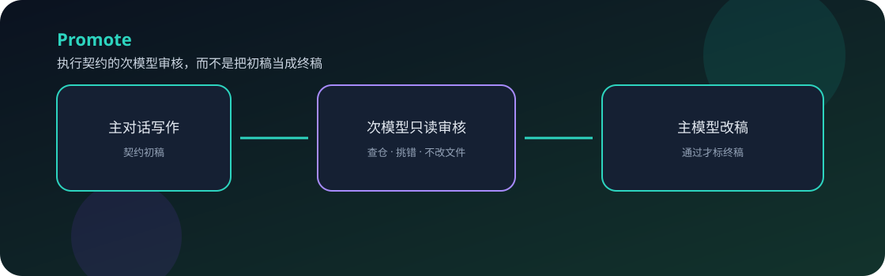
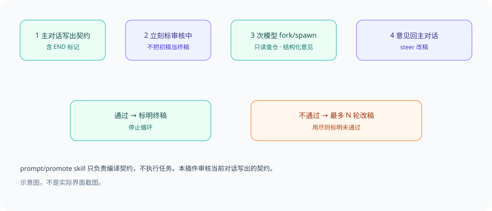

<div align="center">
  
  <h1>Promote</h1>
  <p><strong>当前对话写执行契约，次模型只读挑错，通过之前不要把初稿当成终稿。</strong></p>
  <p>DeepSeek Harness 桌面插件，外加编译契约的 <code>prompt</code> / promote skill。</p>
  <p><strong>简体中文</strong> · <a href="README.en.md">English</a></p>
  <p><a href="LICENSE">MIT</a> · 版本 0.1.22</p>
  <p><a href="#核心能力">核心能力</a> · <a href="#工作方式">工作方式</a> · <a href="#快速开始">快速开始</a> · <a href="#配置">配置</a> · <a href="#验证">验证</a> · <a href="#常见问题">常见问题</a></p>
</div>

---

**Host 兼容要求：** 审核需要 Host 提供可验证的启动前只读保护、可信审核证据接口和工作区读取边界；能力缺失时返回 `READ_ONLY_UNAVAILABLE`，证据不足或读取越界时不会判通过。2026-11-01 在本机定制 DSH Desktop 0.2.2-alpha.2 上完成了非代码材料及受支持的 TypeScript 调用链真实审核；这不代表所有 Host 或语言服务都已验证。仓库里的 `skills/prompt` 只负责**编译**契约，不执行任务。

## 核心能力

<table>
<tr>
<td><strong>自动审核</strong><br/>未引用的结束标记触发；写作轮在钩子内等审完才结束，不依赖主模型调用 <code>promote</code>。</td>
<td><strong>次模型 A / B</strong><br/>先 A；A 撞当前会话主模型或不在 Session 白名单中则用 B。可分别选择推理强度，并写入真实 <code>agentOptions</code>。</td>
</tr>
<tr>
<td><strong>只读保护</strong><br/>启动前保护无法确认时拒绝审核；读取限制在当前任务根；代码类任务必须有可验证的源码和 LSP 证据，通过但附带阻断级问题的结论会被拒绝。</td>
<td><strong>七条审核规则</strong><br/>现场、调用链、事实分层、范围、验收、本机规则、可执行且够短。侧栏与审核端同源。</td>
</tr>
<tr>
<td><strong>循环有上限</strong><br/>默认最多 3 轮（1–5）。未见终稿/未通过标记前，初稿不算合格。</td>
<td><strong>prompt skill</strong><br/>先澄清会改变结果的未知项；非平凡代码任务写入结构设计门，再把目标编成可复制到新会话的执行契约。安装到 <code>~/.dsh/skills/prompt</code>。</td>
</tr>
</table>

## 工作方式



1. 当前对话（或 prompt skill）写出契约，正文含 `[END OF EXECUTION PROMPT]`。
2. 插件注入「审核中」，并在 `turn-stopping` 里等待次模型返回；写作轮此时不标完成。
3. Host 保护和证据可用时执行审核，通过才标终稿；能力缺失时明确失败，可重试的失败按提示处理，统一超时为 1200s。
4. 显式 `promote` 仍可等待或接入进行中的同一哈希审核。

## 快速开始

### 1. 前置条件

- 本机 DeepSeek Harness 桌面端
- 已登录可用于次模型的账号（例如 Grok / GPT / 其它已配置路由）
- 完全退出再打开（⌘Q）后插件才会加载新代码

### 2. 安装插件

复制本仓库到 `$DSH_HOME/plugins/promote`（macOS 默认 `~/.dsh/plugins/promote`）。在 `$DSH_HOME/profiles/desktop/package.json` 加入 link 依赖和 bundle：

```json
{
  "dependencies": {
    "promote": "link:/Users/YOU/.dsh/plugins/promote"
  },
  "dsh": {
    "profile": {
      "bundles": ["promote"]
    }
  }
}
```

在该 desktop 目录安装 link，使包可解析：

```bash
cd "$DSH_HOME/profiles/desktop"
pnpm install
```

包内 `cordis.patch.yml` 会插入 `id: promote`。不要清空已有的 `profiles/desktop/cordis.patch.yml`。

### 3. 安装 prompt / promote skill

```bash
mkdir -p "$DSH_HOME/skills"
cp -R skills/prompt "$DSH_HOME/skills/prompt"
```

在对话里说「生成 prompt」「生成 promote」或使用 `/prompt`。Skill 会先检查是否必须澄清，并按需把类型、签名和模块边界的设计阶段写进契约；它只编译契约，不执行设计或项目修改。

### 4. 配置并验证

完全退出 DeepSeek Harness（⌘Q）再打开。右侧栏打开 **Promote**：

- 配置次模型 A、B 和各自推理强度（A、B 不能相同）
- 保存设置（写入 `$DSH_HOME/storages/promote/settings.json`，权限 0600）
- 当前会话主模型若等于 A，或 A 不在 Session 获准的子模型白名单中，本轮审核改用 B

## 配置

| 项 | 默认 | 说明 |
| --- | --- | --- |
| 次模型 A / B | 未配置 | `provider/model`，可带 `reasoningEffort` |
| 最大修改次数 | 3 | 范围 1–5 |
| 自动审核 | 开 | 关闭后可用显式工具 `promote` |
| 审核超时 | 1200s | Host 常量，不上侧栏 |

未配齐 A/B、A=B、或两者都等于当前会话主模型时，本轮不审，对话和侧栏可见失败，禁止主模型自审。记录过 `subagent/model-selection-policy` 的 Session 只允许选择白名单内路由；未记录该策略的旧 Session 按 DSH 规则只允许当前主模型，而审核又禁止自审，因此会明确拒绝并要求使用新建会话。主模型优先读取活跃会话 Agent 的当前选择；旧版 Agent 没有该接口时读取会话模型投影及请求头。无法确认时显示具体原因并拒绝审核，不以全局默认模型代替。

非代码材料审核需要用户在原始消息中单独一行声明 `非代码范围：仅处理非代码材料`，并在契约或用户原话中指明要检查的实际材料；契约省略“文档/材料”等词时，用户原话仍可提供材料意图。普通文档提到 API、测试或部署不再因此被误判为源码任务；“不涉及源码调用/不适用调用链”等否定性说明也不会触发源码模式。配置类文件必须被实际读取，但不会被逼造不存在的 LSP 调用链。源码审核需要可信 LSP；当前本机验收覆盖受限制的单项目 TypeScript，可信查询不支持 `tsconfig` 的 `extends`、`references` 或 TypeScript 插件。无法绑定源码快照、缺少调用链证据，或审核结论包含 `passed: true` 且仍有阻断级 issue 时会拒绝通过；`minor` 等非阻断建议不会触发重复审核。

调用链节点使用一基行号和 UTF-16 列号；多跳链的中间节点另记录函数体内下一调用点。兼容 Host 须在同一受信 TypeScript 查询中证明该位置是调用点且属于对应函数。除具名函数、方法及 `const` 绑定的函数外，还支持 `const` 绑定、无继承的类表达式中的显式无重载构造器；内联匿名回调只在同文件的 `const` 箭头函数接收它，且该函数顶层直接调用对应形参时建立静态回调边。无法确认归属或调用关系时仍会拒绝通过；静态证据不证明运行时一定执行了相应分支或动态派发目标。

<details>
<summary><strong>进阶：API、数据位置与审核规则</strong></summary>

- API：`/api/promote`（GET/POST）
- 设置：`$DSH_HOME/storages/promote/settings.json`
- 右侧栏 `kind` 为独有的 `promote`
- 审核规则与约束见侧栏：代码类契约需要真实源码读取和 LSP 调用链；非源码任务检查其实际材料。启动前只读或真实工具证据无法验证时不得判通过。

</details>

## 验证

在插件目录、本机 Node（`/usr/local/bin/node`）上：

```bash
/usr/local/bin/node --check lib/index.js
/usr/local/bin/node --check lib/client.js
/usr/local/bin/node --test
```

涉及源码的 prompt skill 契约须用 lsp 核对调用链。单测不能代替 ⌘Q 后的桌面运行态验收；不同 Host、语言服务及项目配置需要分别验证。

## 常见问题

**改完代码页面没变？** 必须 ⌘Q 完全退出，热重载不够。

**侧栏提示未配置？** 下拉框有值也要点「保存设置」。

**刚选的模型又变回旧的？** 侧栏每 4 秒只刷新审核状态，不会覆盖未保存的 A/B。改完模型仍须点「保存设置」。要更新模型列表点「刷新」。

**A 选了当前对话同一个模型？** 会改用 B，这是设计，避免自审。

**skill 和插件什么关系？** skill 生成契约；插件审核当前对话里已经写出来的契约。可以只用其中一个。

**写了契约但没有「审核中」？** 引用行（`>`）和行内代码里的结束标记不审。prompt skill 那种围栏契约会审。改完插件须 ⌘Q。

**主对话为什么像结束了？** 插件在 `turn-stopping` 钩子内等待本轮结果。超时等可重试失败会提示重试；`READ_ONLY_UNAVAILABLE` 需要先恢复可验证的保护能力，不会循环唤醒或提示立即重试。这不是官方 subagent 的 pending 工具心跳。

**侧栏提示旧审核状态未知？** 先确认没有仍需保留的审核；随后点「解除未知审核」并完成确认。该操作会记录一次持久恢复，清除孤儿列表和溢出阻断，但不会把旧子任务结果算作通过。

## 社区与许可

公开仓库 Topic 为 `dsh-plugin`。许可见 [LICENSE](LICENSE)（MIT）。不包含用户设置、凭据或会话记录。

<div align="center"><sub>初稿先审再当终稿 · <a href="README.en.md">Read in English →</a></sub></div>
